<div align="center">


# TabLoom (织页)

**Weave hundreds of chaotic browser tabs into a clean, instant-access AI workbench**

*Chrome MV3 · Native Messaging Local Daemon · ⌘K Multi-Source Vector Search · Auto Idle Sleep · Bilingual 中文 / English*

<p>
  <b>English</b> · <a href="./README.zh-CN.md">简体中文</a> · <a href="./LICENSE">MIT License</a>
</p>

[Product Walkthrough](./docs/media/tabloom-walkthrough.mp4) · [Capabilities](#core-capabilities--solutions) · [Screenshots](#live-screenshots) · [3-Minute Quick Start](#3-minute-quick-start)

</div>

---

> With 60+ open tabs, your browser tab strip shrinks into unreadable favicons; the same technical doc or GitHub PR gets opened four or five times; finding a page you closed yesterday means digging endlessly through History; and your laptop fans spin up because you are afraid to close active work contexts.
>
> **TabLoom** restores a calm **"open to find, leave to lighten"** workflow — all tab organization, semantic search, and idle tab hibernation run in a **local-first loop** on your device without uploading browsing data to unrelated third-party clouds.

## Live Walkthrough

<div align="center">

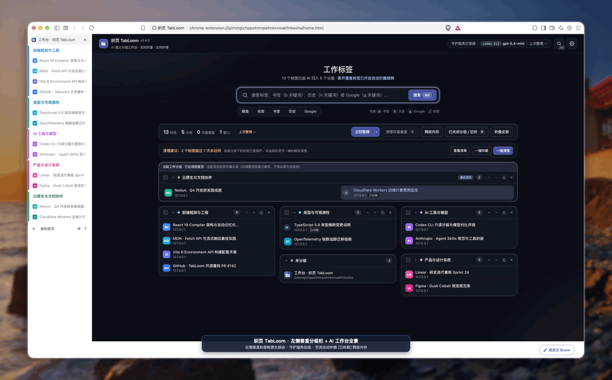

<p><sub>🌀 <b>Auto-playing feature overview GIF</b> (dedicated GIFs per capability below · framed with macOS glass bezel) · 📺 Watch full-resolution walkthrough (<code>2112×1312</code>): <a href="./docs/media/tabloom-walkthrough.mp4"><code>docs/media/tabloom-walkthrough.mp4</code></a></sub></p>

</div>

---

## Core Capabilities & Solutions

| Scenario | Traditional Pain Point | TabLoom Solution |
| --- | --- | --- |
| **Tab overload & messy groups** | Right-clicking to group manually breaks down as soon as you switch tasks | Connects to local read-only AI CLIs (`codex` / `claude`) or local endpoints (Ollama / OpenAI-compatible) to sync native Chrome tab groups semantically; supports **manual pinned group names** (protected from future AI renames) and active work-group pinning |
| **Accidental group deletion** | Bulk cleanup risks deleting key work tabs; closed tabs are hard to recover | **Per-group lock toggle** (blocks auto-cleanup, dedup, and AI reassignment); every group offers two quick-close actions: **Save & Close (Reopenable Archive)** or **Dissolve & Close All Tabs** |
| **Slow tab, bookmark & URL lookup** | Hunting tab-by-tab, or clicking into tabs just to copy a URL | **`⌘K` Command Palette** auto-focuses immediately on open, with **smart direct URL jump**, **one-click Copy URL (`⌘C` / `⌘⇧C`)**, local millisecond `b ` (Bookmarks) / `h ` (History) lookup, plus explicit `g ` Google Search shortcut |
| **Masonry drag jitter & sidebar sync** | Multi-column cards snap awkwardly while dragging; sidebar falls out of sync on tab switch | Built with **SortableJS 1.15.7** (`220ms` animation debounce & `14px` hysteresis); Side Panel listens to window focus, visibility, and tab activation to scroll the active tab smoothly into center view |
| **Duplicate tabs & memory bloat** | Pressing `⌘T` stacks duplicate workspaces; hibernated tabs look identical to active ones | `chrome.tabs.onCreated` intercepts duplicate URLs in real time and **enforces at most 1 New Tab / Workbench per window**; customizable idle hibernation (**5 min ~ 30 days**) adds a **dashed grey outer ring + Sleeping badge**, plus 7-day cleanup hints |
| **Local privacy & speed** | Cloud tab managers require uploading full browsing history and credentials | **Local-First architecture**: Chrome Native Messaging wakes the local `127.0.0.1:8787` Node daemon & read-only CLI on demand; AI short titles and summaries are cached locally (`< 5ms` reuse) |
| **Themes, languages & floating pill** | Disjointed light/dark themes and jarring page overlays | Full synchronized **Dusk Cobalt (Dark) / Crisp Daylight (Light)** and **English / 简体中文** support across Workbench, Side Panel, Popup, Command Palette, and the **adaptive web-page floating pill** |

---

## Live Screenshots

### 1. Vertical Tabs + Dusk Cobalt Workbench

Every new tab opens directly into the TabLoom Workbench synced live with Chrome's native vertical tab tree: live local AI CLI status, Hero multi-source search bar, pinned manual group names, lock & dual-close controls, and hibernated status rings.

<p align="center">
  
</p>

<p align="center">
  
  <br />
  <sub>▲ Demo: Inline manual group rename pin, single-group lock protection, dual close options & archive restoration</sub>
</p>

### 2. ⌘K Direct URL Jump & `b`/`h` Bookmark & History Search

Press `⌘K` to launch the cross-source command palette: paste any URL (with or without `https://`) to promote **Direct URL** at the top (switches to already-open tabs or opens new ones with quick Copy URL); type **`b `** or **`h `** to target Chrome Bookmarks or Browsing History immediately.

<div align="center">
<table>
  <thead>
    <tr>
      <th align="center" width="50%">⌘K Direct URL Detection & Quick Copy</th>
      <th align="center" width="50%"><code>h</code> / <code>b</code> Prefix History & Bookmark Search</th>
    </tr>
  </thead>
  <tbody>
    <tr>
      <td align="center">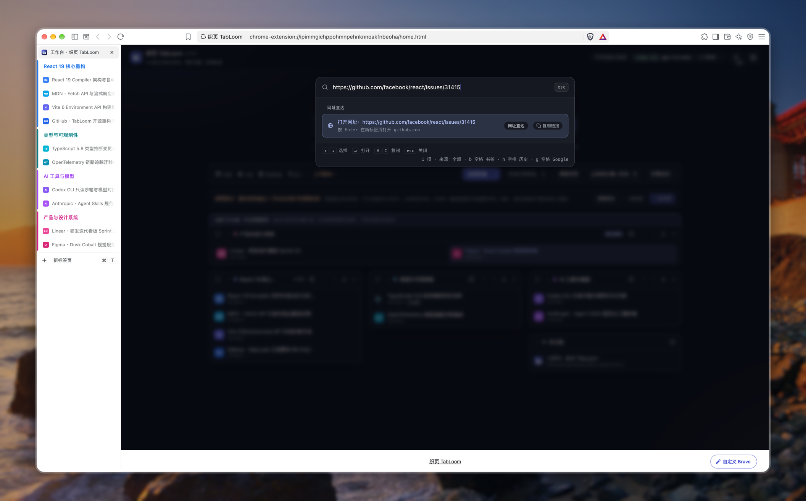</td>
      <td align="center">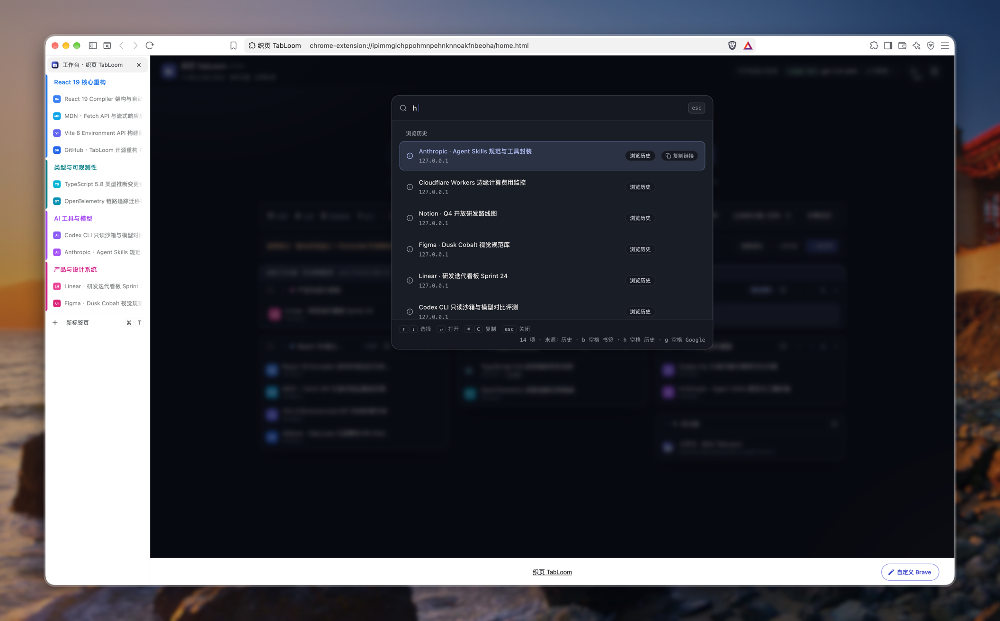</td>
    </tr>
  </tbody>
</table>
</div>

### 3. SortableJS Zero-Jitter Masonry Drag

Hold any sortable group header to reorder cards: a crisp grey placeholder marks the drop target with zero horizontal jitter, syncing native Chrome tab group order on release.

<p align="center">
  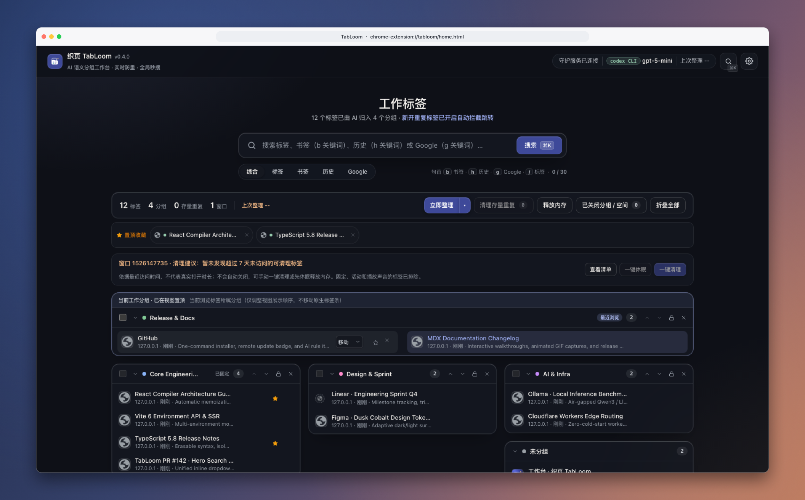
</p>

<p align="center">
  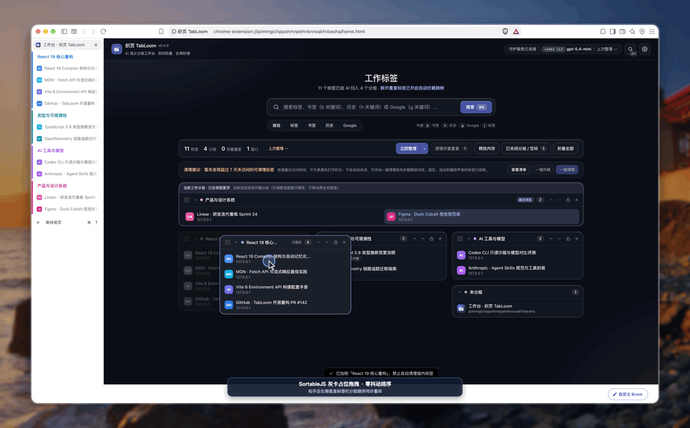
  <br />
  <sub>▲ Demo: SortableJS zero-jitter group drag-and-drop, <code>⌘K</code> direct URL jump & <code>h</code> history search</sub>
</p>

### 4. Native Chrome Side Panel (Settings & Live Tab List Modes)

Click Settings or the toolbar extension icon to dock Chrome's native Side Panel: it renders full configuration while on the Workbench, and automatically switches to a live interactive Tab List as soon as you navigate to any web page.

<div align="center">
<table>
  <thead>
    <tr>
      <th align="center" width="50%">Side Panel Live Tab List (Web Page Active)</th>
      <th align="center" width="50%">Side Panel Full Settings (Workbench Active)</th>
    </tr>
  </thead>
  <tbody>
    <tr>
      <td align="center">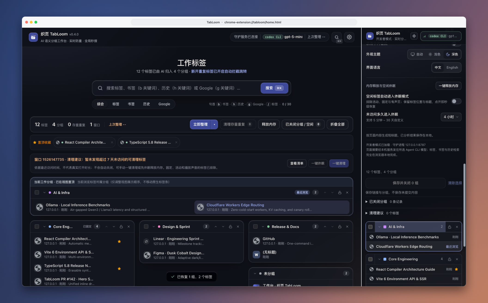</td>
      <td align="center">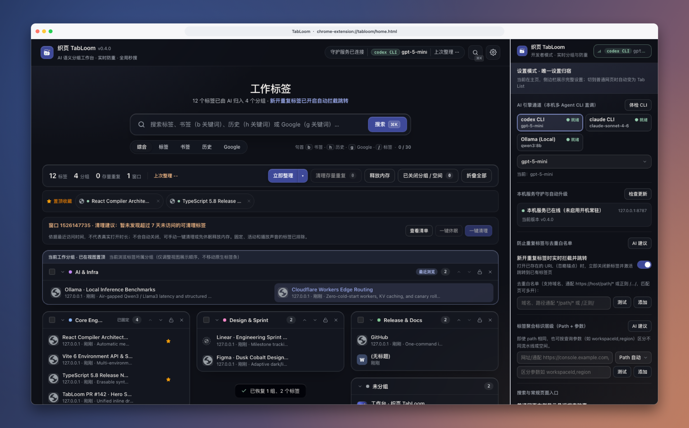</td>
    </tr>
  </tbody>
</table>
</div>

### 5. Dual Themes & Instant `English / 中文` Sync

<div align="center">
<table>
  <thead>
    <tr>
      <th align="center" width="50%">Crisp Daylight Light Theme</th>
      <th align="center" width="50%">English UI Mode (Live Sync)</th>
    </tr>
  </thead>
  <tbody>
    <tr>
      <td align="center">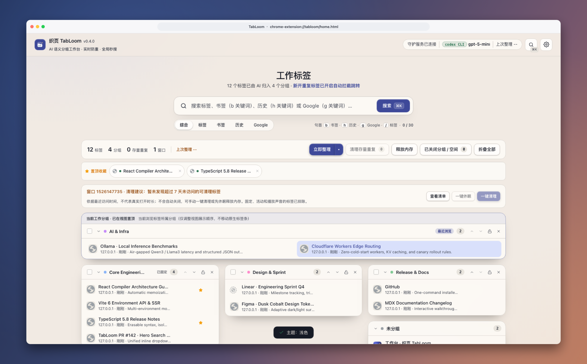</td>
      <td align="center">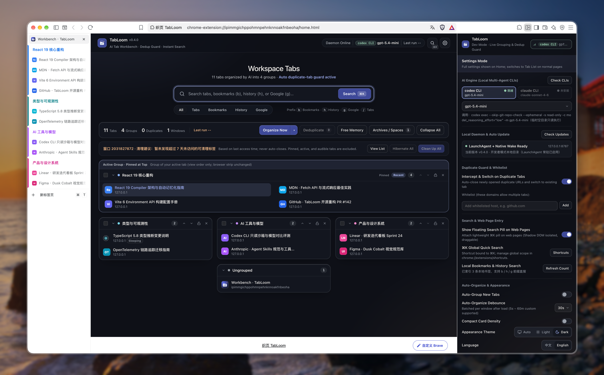</td>
    </tr>
  </tbody>
</table>
</div>

<p align="center">
  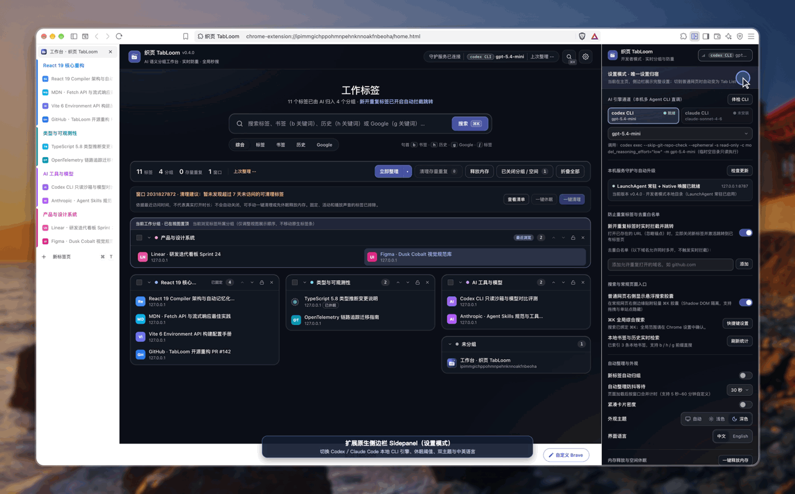
  <br />
  <sub>▲ Demo: Docked Side Panel mode switching, Crisp Daylight theme & instant 中文 / English UI sync</sub>
</p>

---

## Local-First Architecture

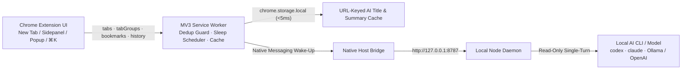

---

## 3-Minute Quick Start

### 1. Enter the Project Directory

```bash
cd tabloom
```

### 2. Load the Chrome Extension (Zero Build Step)

1. Open Chrome / Brave / Edge and visit `chrome://extensions`.
2. Enable **Developer mode** in the top-right corner.
3. Click **Load unpacked** and select the [`extension/`](./extension) directory inside this repository.
4. Open a new tab (or press `⌘K` / `Ctrl+K`) to launch **TabLoom Workbench**.

### 3. Start the Local AI Daemon (Optional, for Semantic Grouping)

```bash
cd server
npm install
node server.mjs
```

To let the extension wake the daemon automatically via macOS LaunchAgent + Chrome Native Messaging (Linux/Windows users simply run `node server.mjs`):

```bash
cd server
npm run service:install
```

> **Permissions note:** `<all_urls>` and `scripting` are used strictly on demand to extract the active page's short snippet for semantic grouping and to mount the optional shadow-DOM floating `⌘K` pill (`127.0.0.1`-only daemon with strict `Host`/`Origin` validation).

Once running, the top-right status badge switches to **Daemon Online** alongside your active local CLI / model.

---

## Directory Structure & Verification

```text
├── extension/              # Chrome MV3 extension source (vanilla JS/CSS, zero build step)
│   ├── icons/              # TabLoom icons (16 / 32 / 48 / 128px)
│   ├── vendor/             # Open-source dependency (SortableJS 1.15.7)
│   ├── home.*              # New Tab AI workbench (masonry drag, hero search, settings drawer)
│   ├── sidepanel.*         # Native Side Panel (Live Tab List + Full Settings dual modes)
│   ├── palette.js          # ⌘K unified search (Direct URL / Tabs / Bookmarks b / History h / Google g)
│   ├── background.js       # Dedup guard, Native Host wake-up, idle sleep scheduler & group sync
│   ├── i18n.js             # Live 中文 / English translation engine
│   └── ui.js               # Vector scoring, SearchableSelect, theme engine & toast notifications
├── server/                 # 127.0.0.1:8787 local AI daemon & multi-CLI adapter
├── docs/                   # Screenshots, animated GIFs & product walkthrough video
├── scripts/                # 20 unit test suites + Brave CDP real-browser E2E suite
└── LICENSE                 # MIT License
```

Run tests:

```bash
# Run all 20 Node unit test suites
for f in scripts/test-*.mjs; do node "$f"; done

# Run full real Brave + CDP end-to-end verification
node scripts/e2e-real-browser.mjs
```

---

## License

This project is licensed under the [MIT License](./LICENSE).
