<div align="center">


# 织页 TabLoom

**把失控的百个标签页，编织成清爽、秒级直达的 AI 工作台**

*Chrome MV3 · Native Messaging 本地守护 · ⌘K 多源向量搜索 · 空闲自动休眠 · 中文 / English*

<p>
  <a href="./README.md">English</a> · <b>简体中文</b> · <a href="./LICENSE">MIT License</a>
</p>

[产品实操演示](./docs/media/tabloom-walkthrough.mp4) · [1 分钟一键安装](#1-分钟快速安装零构建--一行命令) · [核心能力](#核心能力与场景解法) · [实机截图展示](#实机截图一览)

</div>

---

> [!TIP]
> ### ⚡ 1 分钟一键安装 / 更新（零构建 · 一行命令）
> ```bash
> git clone https://github.com/jackerjay/tabloom.git ~/tabloom && ~/tabloom/install.sh --open
> ```
> 自动克隆至 `~/tabloom`、检测 Node 18+、注册 macOS `LaunchAgent`（`com.aitab.organizer`）与 `NativeMessagingHosts`、自动发现本机 Chrome / Brave / Edge / Arc 已加载的扩展 ID，并在 Finder 高亮 `~/tabloom/extension` 供 `chrome://extensions` 加载。日常升级重跑 `./install.sh` 即可（卸载常驻：`./install.sh --uninstall`）。

> 开着 60 个标签页时，浏览器顶部只剩一排无法辨认的 favicon；同一篇技术文档或 GitHub PR 重复打开了四五个；想找昨天刚关掉的页面却要在 History 里大海捞针；风扇狂转却不敢随便关闭工作现场。
>
> **织页 TabLoom** 让浏览器重新恢复「**打开即找到、离开即减负**」的秩序感——标签/书签/历史检索、工作台缓存与休眠调度全量在**本机闭环运行**（`127.0.0.1` 守护进程）；如需完全离线推理可搭配本地 **Ollama**，或按需复用本机已登录的 **Codex / Claude CLI**。

## 产品实操演示

<div align="center">

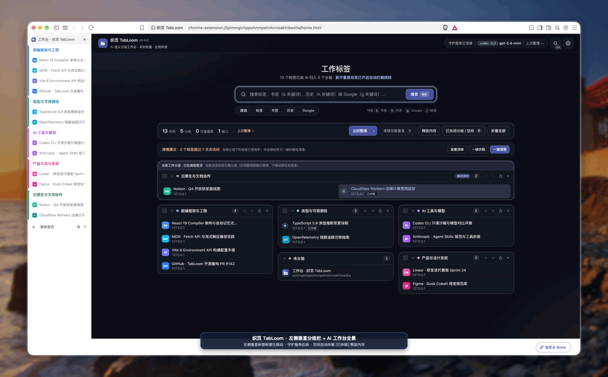

<p><sub>🌀 <b>开箱即播自动循环 GIF 总览</b>（下文各核心功能小节另附场景化高清 GIF · macOS 系统壁纸质感封装） · 📺 查看完整高清视频（<code>2112×1312</code>）：<a href="./docs/media/tabloom-walkthrough.mp4"><code>docs/media/tabloom-walkthrough.mp4</code></a></sub></p>

</div>

---

## 核心能力与场景解法

| 场景痛点 | 传统痛点 | 织页 TabLoom 解法 |
| --- | --- | --- |
| **百页堆积、分组失序** | 手动右键新建分组，切换需求又全部打散 | 接入本机只读 AI CLI（`codex` / `claude`）或本地模型（Ollama / OpenAI 兼容接口），按页面内容语义自动同步 Chrome 原生分组；支持**手动命名分组固定名称**（后续 AI 自动整理不改名）与工作分组记忆锚点 |
| **误清重要分组 / 关闭方式单一** | 一键清理怕误删核心需求页，彻底关闭后难找回 | 新增**分组加锁保护**（阻止自动清理、去重与 AI 移出）；每个分组均支持快速关闭双选项：**「关闭分组（保留可重开）」** 或 **「解散并彻底关闭所有标签页」** |
| **找标签 & 翻历史 & 复制/直达网址** | 逐个盲翻标签，贴入长网址或想复制某条链接还要点开切换 | **`⌘K` 命令面板**打开即自动聚焦，支持 **URL 自动识别直达**、一键**快捷复制链接（按钮 & `⌘C`/`⌘⇧C`）**；本地毫秒级检索 `b `（书签）/ `h `（历史），并支持显式 `g ` 快捷打开 Google 网页搜索 |
| **瀑布流拖拽抖动 & 侧边栏跟随** | 多列卡片相互挤压跳变，切换标签后侧边栏未及时滚动定位 | 内置 **SortableJS 1.15.7**，结合 `220ms` 动画防抖锁与 `14px` 指针滞回；侧边栏监听窗口焦点、显示切换与标签激活，自动居中滚动定位当前标签 |
| **单新标签页 & 防重 & 休眠标记** | `⌘T` 反复堆积多个空白工作台；后台休眠标签难一眼分辨 | `chrome.tabs.onCreated` 实时防重拦截，并**保证单窗口最多保留 1 个「新标签页 / 工作台」**；支持 **5 分钟 ~ 30 天**自定义闲置休眠（原生 Discard，**休眠图标加圆形灰色虚线外圈 +「已休眠」徽章**）及 7 天清理建议 |
| **团队协作与隐私顾虑** | 第三方云端扩展要求上传完整浏览记录与账号权限 | **Local-First 本地架构**：Chrome Native Messaging 自动拉起 `127.0.0.1:8787` 本地 Node 服务与只读 CLI；AI 短标题与摘要本地缓存（命中 `< 5ms` 复用），控制面零云端强依赖 |
| **双主题 & 双语 & 悬浮胶囊** | 浅深主题割裂、普通网页呼出入口黑色突兀 | 完整适配 **Dusk Cobalt 深色 / Crisp Daylight 浅色**及 **`中文 / English` 实时同步切换**（覆盖工作台、侧边栏、弹窗、命令面板及**普通网页右侧悬浮搜索胶囊**，点击胶囊直接激活聚焦 `⌘K`） |

---

## 实机截图一览

### 1. 垂直标签栏 + Dusk Cobalt 全局工作台

打开新标签页即进入 织页 TabLoom 工作台，与浏览器左侧垂直分组标签树同步联动：实时展示本机 AI CLI 在线状态、Hero 多源搜索框、分组手动固定名称、加锁保护与快速关闭菜单、以及闲置「已休眠」状态标识。

<p align="center">
  
</p>

<p align="center">
  
  <br />
  <sub>▲ 动图演示：分组内联重命名固定（「React 19 核心重构」）、单组加锁防自动清理、快速关闭双选项与工作空间恢复</sub>
</p>

### 2. ⌘K URL 自动直达 & `b`/`h` 地址栏式书签/历史检索

按 `⌘K` 打开跨源命令面板：贴入任意网址（含省略协议域名）自动在顶部高亮 **「网址直达」**，已打开网页直接切换激活、未打开一键开启，支持一键复制链接；输入 **`b `** 或 **`h `** 直接定向检索 Chrome 书签或浏览历史。

<div align="center">
<table>
  <thead>
    <tr>
      <th align="center" width="50%">⌘K URL 自动识别直达</th>
      <th align="center" width="50%"><code>h</code> / <code>b</code> 关键字定向检索浏览历史与书签</th>
    </tr>
  </thead>
  <tbody>
    <tr>
      <td align="center">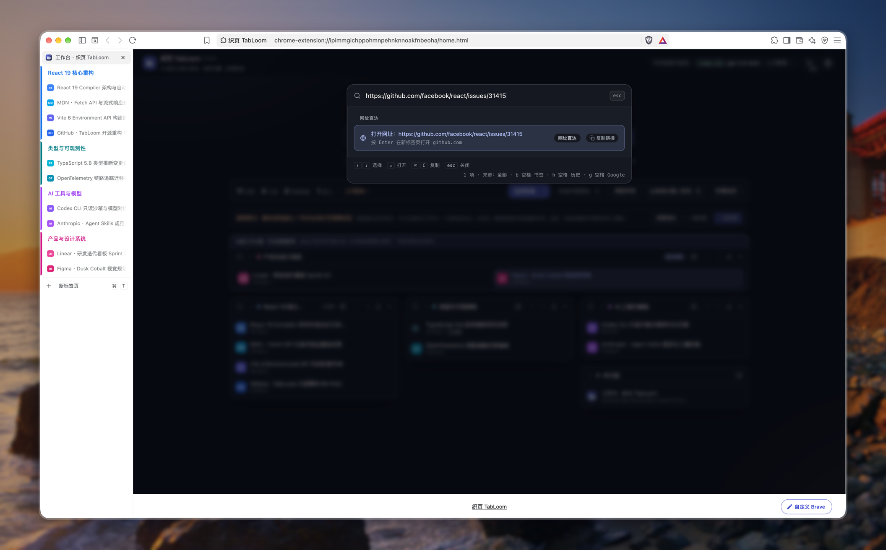</td>
      <td align="center">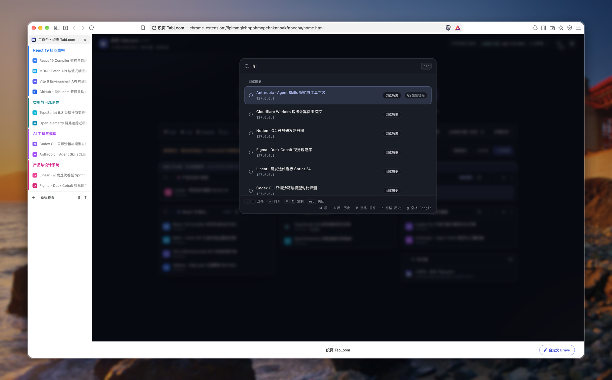</td>
    </tr>
  </tbody>
</table>
</div>

### 3. SortableJS 零抖动瀑布流拖拽（实体灰卡占位）

按住任意可排序分组标题栏拖动即可调整位置：目标位置展示清晰的灰色卡片占位轮廓，全程零横向挤压抖动，松手即时同步浏览器垂直/顶部标签组顺序。

<p align="center">
  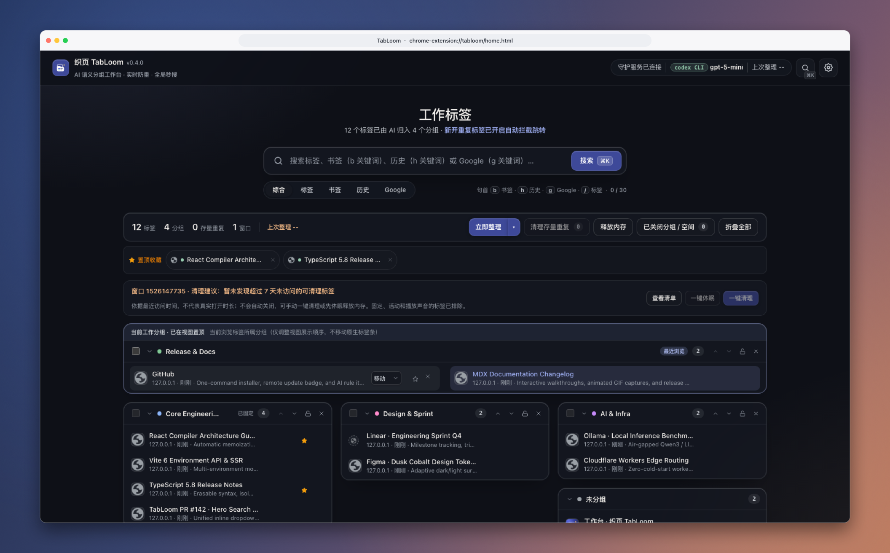
</p>

<p align="center">
  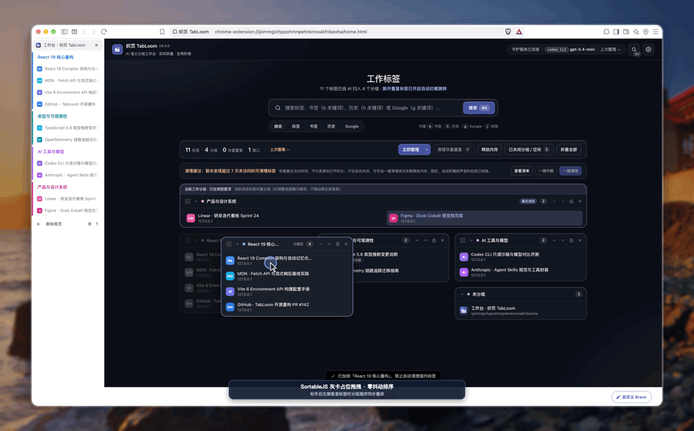
  <br />
  <sub>▲ 动图演示：SortableJS 灰卡占位零抖动拖拽排序、<code>⌘K</code> URL 自动识别直达与 <code>h</code> 历史检索</sub>
</p>

### 4. 原生侧边栏 Sidepanel 三栏联动（全量设置 & 实时分组视图）

点击工作台右上角设置或工具栏扩展图标即唤起浏览器原生右侧 Sidepanel：在工作台页展开**完整设置面板**，切换到普通文档/代码网页时自动变身为**实时分组列表**，左中右三栏协同无遮挡。

<div align="center">
<table>
  <thead>
    <tr>
      <th align="center" width="50%">Sidepanel 实时分组视图（切到文档网页）</th>
      <th align="center" width="50%">Sidepanel 全量设置视图（工作台协同）</th>
    </tr>
  </thead>
  <tbody>
    <tr>
      <td align="center">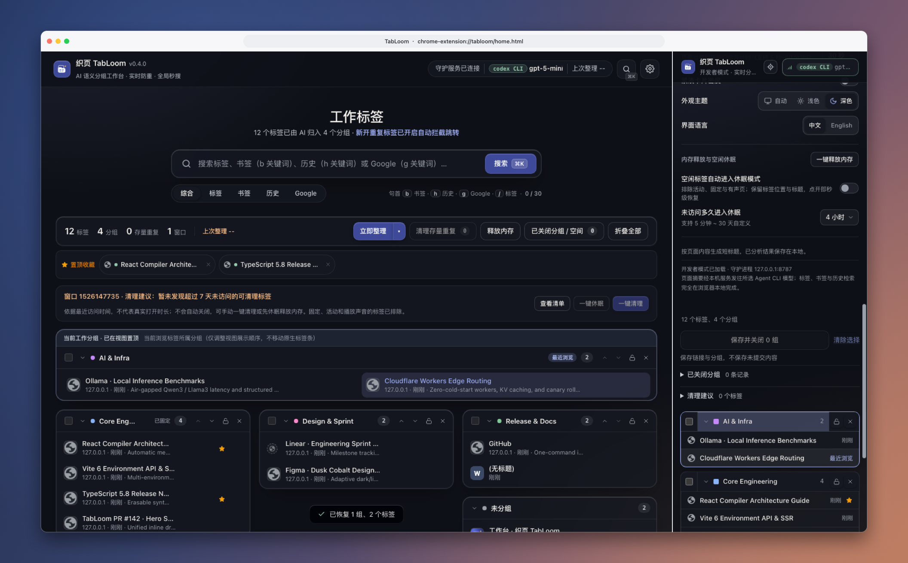</td>
      <td align="center">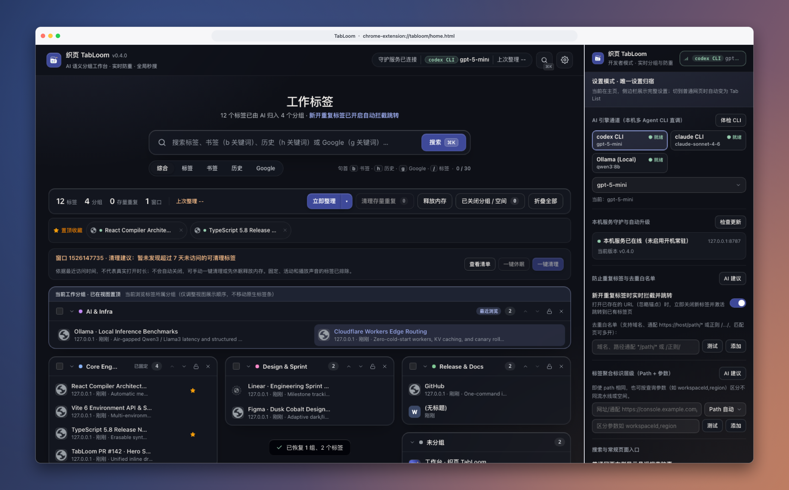</td>
    </tr>
  </tbody>
</table>
</div>

### 5. 白昼双主题与 `中文 / English` 即时切换

<div align="center">
<table>
  <thead>
    <tr>
      <th align="center" width="50%">Crisp Daylight 浅色工作台</th>
      <th align="center" width="50%">English Workbench（双语实时切换）</th>
    </tr>
  </thead>
  <tbody>
    <tr>
      <td align="center">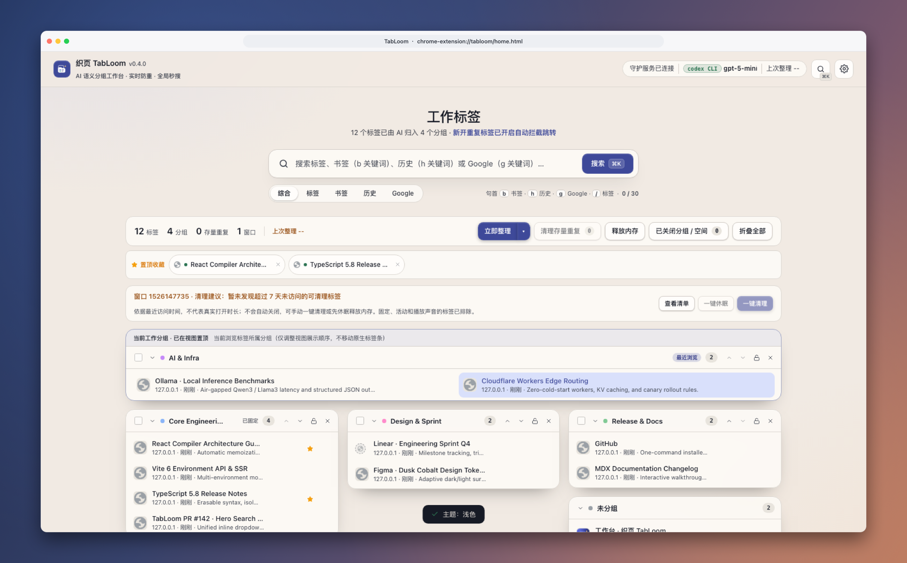</td>
      <td align="center">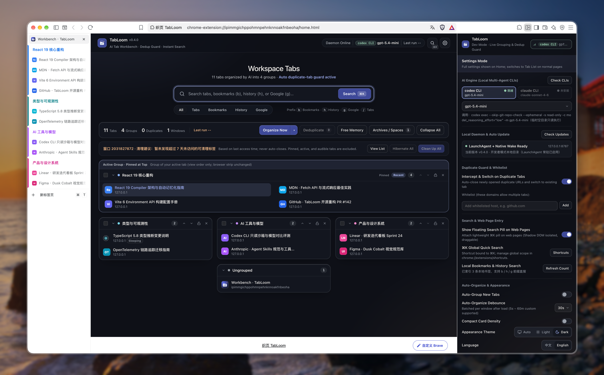</td>
    </tr>
  </tbody>
</table>
</div>

<p align="center">
  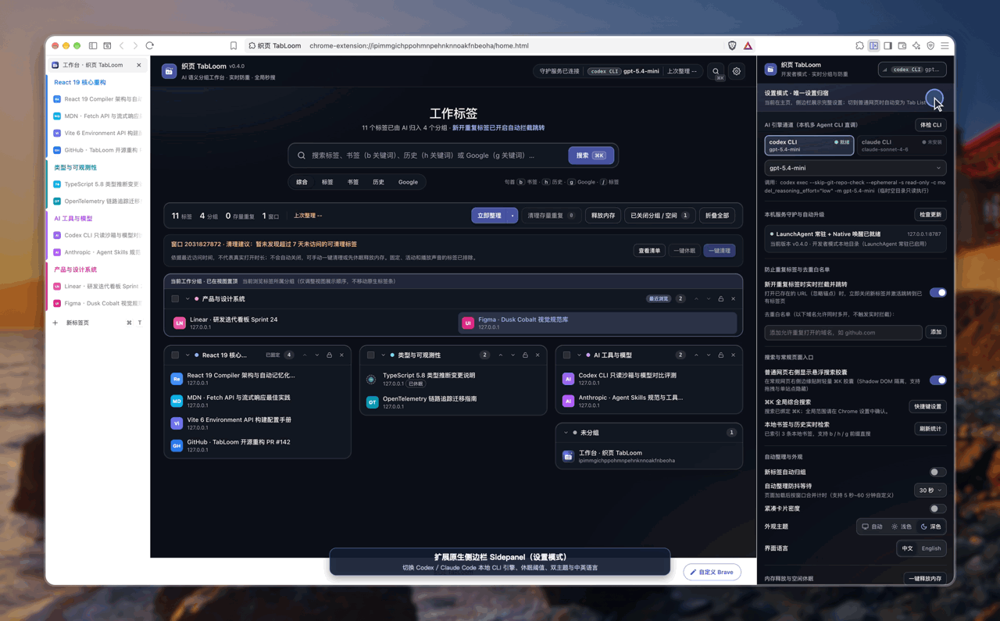
  <br />
  <sub>▲ 动图演示：原生停靠侧边栏设置/列表自动切换、Crisp Daylight 浅色主题与中文 / English 实时联动</sub>
</p>

---

## 本地守护架构（Local-First）

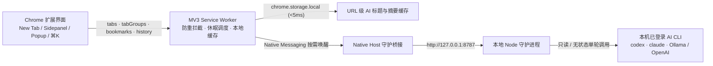

---

## 1 分钟快速安装（零构建 · 一行命令）

### 1. 一条命令安装或更新本地 AI 守护服务

```bash
# 未下载仓库时（克隆 + 检测 Node 18+ + 安装 LaunchAgent 与 Native Messaging + 校验 127.0.0.1:8787）
git clone https://github.com/jackerjay/tabloom.git ~/tabloom && ~/tabloom/install.sh --open
```

> 若已经克隆仓库，直接在根目录执行 **`./install.sh`**（或 `npm run setup`）即可幂等升级并重启服务；如需同时安装可选 ACP npm 依赖可传 `--with-acp`；卸载常驻运行 `./install.sh --uninstall`。

### 2. 加载 Chrome 扩展（仅首次需要）

1. 打开 Chrome / Brave / Edge 浏览器，访问 `chrome://extensions`。
2. 开启右上角 **开发者模式（Developer mode）**。
3. 点击 **加载已解压的扩展程序（Load unpacked）**，选择 `~/tabloom/extension`（传入 `--open` 时会自动在 Finder 高亮）。
4. 打开一个新标签页（或按 `⌘K`），即可进入 **织页 TabLoom** 工作台。

> **权限说明**：`<all_urls>` 与 `scripting` 仅在工作需要时用于提取当前标签页摘要（用于本地/CLI 语义归组）及渲染可关闭的 Shadow DOM 右侧悬浮 `⌘K` 胶囊；本地服务强制校验本机 `127.0.0.1` 回环地址与可信扩展来源 `Origin`。

运行成功后，工作台右上角将显示 **「守护服务已连接」** 与当前激活的本地 CLI 模型。

---

## 目录结构与测试验证

```text
├── extension/              # Chrome MV3 扩展源码（纯原生 JS/CSS，无构建步骤）
│   ├── icons/              # 织页 TabLoom 品牌图标（16 / 32 / 48 / 128px）
│   ├── vendor/             # 开源依赖（SortableJS 1.15.7）
│   ├── home.*              # 新标签页 AI 工作台（含瀑布流拖拽、Hero 搜索、抽屉设置）
│   ├── sidepanel.*         # 原生侧边栏（标签视图 + 一键定位 + 置顶收藏 + 全量设置）
│   ├── palette.js          # ⌘K 分层搜索面板（网址直达 / 标签 / 书签 b / 历史 h / Google g）
│   ├── background.js       # 防重拦截、Native Host 唤醒、休眠调度与组同步
│   ├── i18n.js             # 中 / 英双语实时翻译引擎
│   └── ui.js               # 向量余弦评分、通用 SearchableSelect、主题系统与 Toast
├── server/                 # 127.0.0.1:8787 本地 AI 守护与多 CLI 适配器
├── docs/                   # 产品宣传截图与实操演示视频/GIF
├── scripts/                # `tabloom` CLI + 25 组单元测试 + Brave CDP 端到端回归
└── LICENSE                 # MIT 开源协议
```

运行回归测试：

```bash
# 运行核心检索、向量排序、前缀匹配等 Node 单元测试
for f in scripts/test-*.mjs; do node "$f"; done

# 运行真实 Brave + CDP 全链路端到端验证
node scripts/e2e-real-browser.mjs
```

---

## 开源协议

本项目基于 [MIT License](./LICENSE) 开源。
